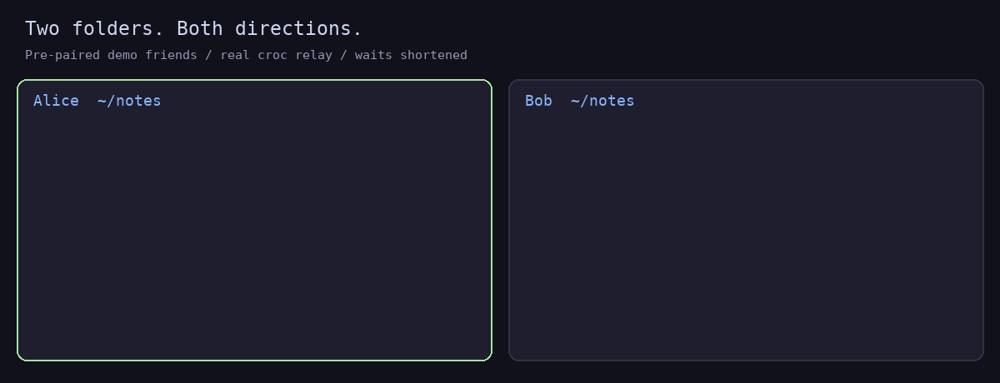
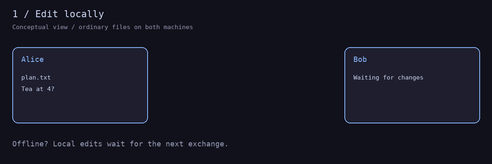
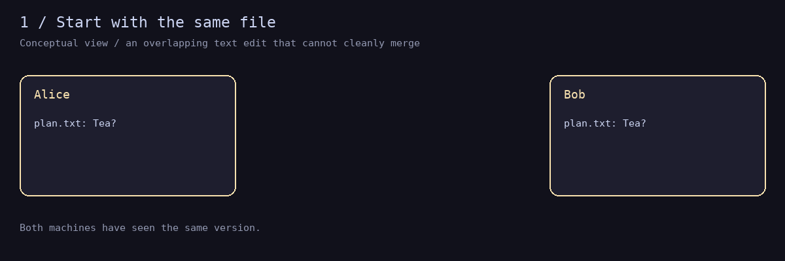

# share

Send files to a friend. Keep a folder in sync across two machines.
Powered by [croc](https://github.com/schollz/croc).

## Install

```sh
# macOS / Homebrew
brew install dhruv-hhai/tap/share

# Linux (requires Git for installation and updates)
curl -fsSL https://raw.githubusercontent.com/dhruv-hhai/share/main/install | bash
```

Runs on Bash 3.2+, croc and standard Unix tools. Sync uses no Git, Python or Perl.
Want a guided tour? Run `share tutorial`.

## Pair once

```sh
# Alice: create an invite for Bob
share friends invite bob

# Bob: accept using Alice's one-time code
share friends accept alice <code>
```

Follow the printed instructions to reload your shell, then choose send or sync.

## Send a folder

```sh
# Alice
share push --friend bob ./notes

# Bob (receives ~/share/alice/notes/)
share pull --friend alice
```


## Two-way sync

Choose a folder on each machine. Use role `a` on one side and `b` on the other.
Both folders can start empty; edits travel both ways.

```sh
# Alice
mkdir -p ~/notes
share sync --friend bob --role a --dir ~/notes

# Bob
mkdir -p ~/notes
share sync --friend alice --role b --dir ~/notes
```

Already pulled Alice's folder? Bob can use `--dir ~/share/alice/notes` instead.
Sync runs in the background. Keep one friend per folder.



*Real command session, rendered as two terminals; local croc relay, waits shortened.*

```sh
share sync status
share sync log --friend bob
share sync stop --friend bob
share sync --friend bob       # resume; folder and role are remembered
```

After a reboot, run the last command again. To restart an unhealthy sync:
`share sync check --repair`.

## How it works

Each machine watches its folder, sends changes through croc, and applies the
other side's changes. You edit ordinary files; sync keeps its state in `.share/`.



Versions remember which earlier edits they have seen. A later edit replaces an
earlier one. Two edits made independently are both kept, so both machines reach
the same result even if messages arrive twice or out of order.



| What happens… | What share does |
| --- | --- |
| One machine goes offline | Keeps local edits and exchanges them when both sides are running again. |
| Both edit the same file | Cleanly merges eligible text edits when possible; otherwise keeps an original plus `.conflict-…` copies on both sides. The same content hash wins on both machines. |
| One deletes while the other edits | Keeps the concurrent edit. An ordinary delete propagates to both sides. |
| A transfer stalls or a machine wakes | Retries automatically. `waiting-peer` is normal when the other side is offline. |
| A file changes during receive | Checks it before replacement and defers a changed file. A final save/rename race is still possible; keep backups. |
| Disk space is low | Defers incoming payloads until there is enough room. |
| Files should stay private | Add patterns to `.shareignore`. `.git/`, `.share/` and common editor temporary files are excluded automatically. `.gitignore` is not used. |
| A path is unsupported | Only regular files sync. Symlinks and tab/newline names are skipped; file/folder collisions need a manual rename. |

`share sync history --friend bob` shows an activity log, **not a backup**.
Keep `.share/`: it holds the identity and version state for that folder.

## More

- [Sync settings, health, ignores and upgrades](docs/sync-reference.md)
- [Design and limits](docs/sync-crdt.md)
- `share --help` and `share <command> --help`

**Upgrading from 1.x?** Stop and upgrade both sides together, and copy desired
`.gitignore` exclusions into `.shareignore`. [Migration and rollback](docs/sync-reference.md#upgrade-from-1x-and-rollback).
Same-major updates are automatic; set `SHARE_AUTO_UPDATE=0` to disable them.
